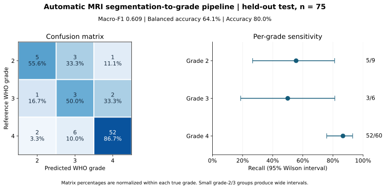
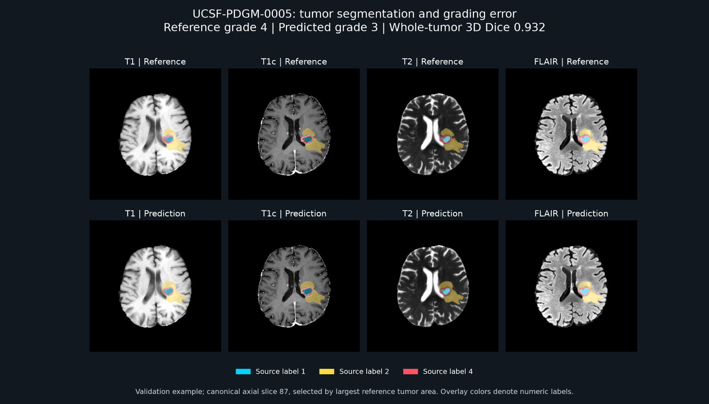
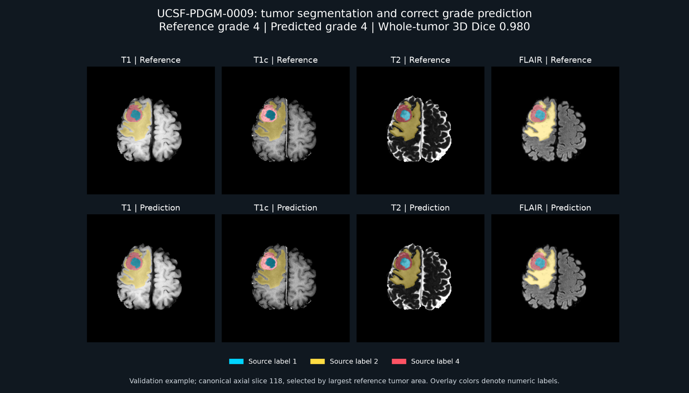

# Brain MRI Tumor Segmentation and Grade Prediction

**Status: In development.** Environment setup and core MRI transfer are verified; automated image auditing passed; three-exam visual QC is complete and patient-disjoint splits are created. The segmentation-to-grade pipeline has completed held-out evaluation: segmentation mean foreground Dice 0.8438; automatic-crop grade macro-F1 0.6086 and balanced accuracy 0.6407 on 75 patients.

A personal medical imaging project developing a reproducible deep learning pipeline to segment diffuse gliomas and predict CNS WHO grade from preoperative MRI using UCSF-PDGM. Development and training use Case Western Reserve University's Markov HPC cluster.

## Held-out pipeline results

Segmentation mean foreground Dice: **0.8438**. Grading uses automatic segmentation crops and the fixed epoch-17 classifier on the same 75 held-out patients.

| Grading metric | Estimate | 95% stratified patient-bootstrap interval |
| --- | ---: | ---: |
| Macro-F1 | 0.6086 | 0.4593–0.7522 |
| Balanced accuracy | 64.1% | 46.9%–81.3% |
| Accuracy | 80.0% | 70.7%–88.0% |

Intervals use 10,000 within-grade bootstrap resamples of a fixed trained model and do not capture training or external-site variability. The grade-2 and grade-3 test groups contain only 9 and 6 patients. See [verified predictions and uncertainty methods](docs/grade-test-analysis.md).



## Model package

The frozen inference checkpoints have been packaged and independently verified against the recorded SHA-256 hashes. The archive contains no MRI files. See [environment setup, archive verification, and inference instructions](docs/model-package.md). The [v1.0.0 model release](https://github.com/ankithjr/brain-mri-tumor-segmentation-and-grade-prediction/releases/tag/v1.0.0) is published; GitHub reports the expected asset size and matching SHA-256 digest. Weights are kept out of Git history.

## Single-exam inference

A new [inference command](docs/single-case-inference.md) accepts four preprocessed MRI sequences and produces a tumor mask, predicted grade, and uncalibrated class probabilities using the frozen pipeline. CPU preprocessing parity tests pass. Markov job 58407 completed the full GPU pipeline with exit code 0:0 on validation exam UCSF-PDGM-0005; class probabilities matched the prior validation run at the displayed eight-decimal difference precision. This is a reproducibility check, not an accuracy improvement: reference grade 4 was predicted as grade 3. See the [integration record](results/single-case-inference-integration.json). The [demo batch script](slurm/predict_case_demo.sbatch) uses an already evaluated validation exam without retraining.

## Qualitative validation error example



For this previously evaluated validation exam, whole-tumor 3D Dice is **0.9319**, yet the classifier predicts **grade 3** for reference **grade 4**. Per-label 3D Dice is 0.9083 (source 1), 0.9117 (source 2), and 0.8387 (source 4). Whole-tumor Dice measures the union of foreground labels and differs from mean foreground class Dice reported for the cohort.

The displayed canonical axial slice (index 87) was selected by largest reference tumor area. This known grading error is an illustrative example, not a representative sample or evidence of the cause of the error. The probabilities are uncalibrated. See [case metrics and selection record](results/case-0005-review.json); data attribution and license are below.

## Correctly graded validation example



UCSF-PDGM-0009 is the first correctly graded validation exam by sorted exam ID. Reference and predicted grades are both **4**; whole-tumor 3D Dice is **0.9796**. Per-label Dice is 0.9537 (source 1), 0.9716 (source 2), and 0.9489 (source 4). The uncalibrated grade-4 softmax output is 0.8980.

The displayed canonical axial slice (index 118) has the largest reference tumor area. This selected success and the error example above illustrate individual outcomes; neither is a representative sample or a replacement for cohort metrics. See [case metrics and selection record](results/case-0009-review.json). Whole-tumor Dice measures the union of foreground labels, not the cohort's mean foreground class Dice. Both figures use UCSF-PDGM data; attribution and license are below.

## Project Focus

- Multisequence **brain MRI**
- Tumor **segmentation**
- CNS WHO **grade prediction**
- Patient-disjoint evaluation
- Reproducible PyTorch/HPC workflow
- Explicit handling of class imbalance and dataset leakage risk

The baseline has completed environment checks, data validation, training, and held-out evaluation. Results and remaining limitations are documented below.

## Planned pipeline

1. Validate multisequence MRI, tumor masks, and clinical labels.
2. Establish patient-disjoint training, validation, and test splits.
3. Train a tumor segmentation baseline.
4. Train a classifier to predict WHO grades 2, 3, and 4.
5. Evaluate segmentation with Dice and classification with macro-F1, balanced accuracy, per-class recall, and confusion matrices.
6. Publish reproducible experiments, error analysis, and selected visual results.

The baseline pipeline has completed evaluation; portable inference and qualitative error analysis remain in development. Tumor grade is distinct from conventional cancer stage. This is a research and educational project, not a clinical diagnostic tool.

## Verified progress

- Python 3.11.5 environment created on Markov.
- PyTorch 2.7.1+cu126 installed; GPU matrix multiplication verified on an NVIDIA GeForce RTX 2080 Ti (11 GB).
- NumPy, SciPy, pandas, NiBabel, scikit-learn, Matplotlib, and tqdm installed.
- Package imports, NumPy-to-GPU interoperability, and dependency checks passed.
- Clinical metadata inspected: 501 exam records containing 56 grade-2, 43 grade-3, and 402 grade-4 labels before patient reconciliation or exclusions.
- Core MRI archive transferred to HPC with matching Windows/HPC SHA-256 checksums.
- Extracted 2,505 NIfTI files; all passed full gzip stream integrity checks (zero failures). See [validation record](results/data-transfer-validation.json) and [reusable validator](scripts/validate_gzip.py). The subsequent automated audit passed for all 501 exams: one file per required modality, matching 3D shapes and affines within each exam, finite voxels, and nonempty integer tumor masks. Observed mask labels are 0, 1, 2, and 4. Exam IDs match metadata and follow-up grouping identifies 495 patients. See [audit script](scripts/audit_dataset.py) and [aggregate audit](results/dataset-audit.json). A visual spot-check of one initial exam per grade found no obvious cross-sequence mask displacement; this is not a full annotation review. Label semantic verification remains pending.
- nnU-Net 2.8.1 installed with the original environment as constraints; imports and `pip check` passed, with PyTorch remaining 2.7.1+cu126. The expanded [nnU-Net package snapshot](requirements-nnunet-lock.txt) is archived. Dataset conversion completed: Dataset501_UCSFPDGM contains 1,680 image symlinks and 420 converted masks for development exams only; all 75 test exams are excluded. Source label 4 is remapped to 3 in new mask copies; originals are preserved. Planning and 3D full-resolution preprocessing completed for all 420 development exams (preprocessing stage: 7 min 55 s). The installed [fixed split](configs/Dataset501_UCSFPDGM/splits_final.json) exactly matches the archived 346/74 CSV assignments. The [plans](configs/Dataset501_UCSFPDGM/nnUNetPlans.json) use PlainConvUNet, batch size 2, patch size 128 × 192 × 128, 1 mm isotropic spacing, and per-image masked Z-score normalization. The executed [SLURM script](slurm/preprocess.sbatch) is archived. Planning used the pooled development cohort; validation is therefore an internal development estimate, while the 75 test exams remain outside planning and preprocessing. A separate [GPU smoke test](scripts/smoke_train.py) completed five training batches and two validation batches on an H100 NVL MIG 1g.12gb slice (10.75 GiB visible), peaking at 7.0 GiB allocated. See the [execution record](results/smoke-test.json). Checkpointing and compilation were disabled. The [full baseline batch job](slurm/train_baseline.sbatch) completed with SLURM exit code 0. On 74 validation exams, nnU-Net reported mean foreground Dice 0.8627; per-class Dice was 0.8682 (source label 1), 0.8612 (source label 2), and 0.8587 (source label 4, remapped to 3). See [aggregate validation results](results/validation-baseline-aggregate.json). Using checkpoint_final.pth (fixed before test evaluation), 75 held-out exams yielded mean foreground Dice 0.8438 and mean IoU 0.7731. Per-class Dice was 0.8356 (source label 1), 0.8553 (source label 2), and 0.8404 (source label 4, remapped to 3). See [aggregate test results](results/test-baseline-aggregate.json). These are single-institution results. The class Dice averages include 62, 75, and 65 cases respectively; reference masks contained the respective classes in 61, 75, and 63 cases. nnU-Net omits undefined scores when both prediction and reference are empty.
- Image-only grade-classifier preprocessing completed for 346 training and 74 validation exams. The [preparation script](scripts/prepare_classifier.py) uses four MRI channels, per-scan nonzero-voxel z-score normalization, clipping, and linear resizing to 96 × 96 × 64. A sample check passed, and a small 3D CNN trained with class-weighted cross entropy stopped after 16 epochs (best at epoch 1). On 74 validation exams, macro-F1 was 0.2957 and balanced accuracy 0.3333. All predictions were grade 4, equivalent to a majority-class baseline; see [validation record](results/grade-baseline-validation.json). The whole-brain classifier baseline was not evaluated on the test set. The exact [baseline training script](scripts/train_classifier.py) and [SLURM script](slurm/train_classifier.sbatch) are archived. A [balanced-sampling experiment](scripts/train_classifier_balanced.py) completed with early stopping: best validation macro-F1 0.3892, balanced accuracy 0.3997 at epoch 7. It correctly predicted 2/8 grade-2, 0/7 grade-3, and 56/59 grade-4 cases. The epoch-7 selected checkpoint also predicts no grade 3 cases in the training set (train macro-F1 0.4347, validation macro-F1 0.3892); later epochs reached very low training loss but did not improve selection score. See [training fit check](results/grade-balanced-fit-check.json) and [validation results](results/grade-balanced-validation.json); class scores are based on small validation counts, and these whole-brain experiments were not evaluated on the test set.
- Oracle tumor-crop grading experiment completed (32 epochs; selected epoch 17): validation macro-F1 0.6858 and balanced accuracy 0.7399 on 74 exams. Correct grade predictions were 6/8, 4/7, and 53/59 for grades 2, 3, and 4. Crops use supplied reference tumor masks with a 16-voxel margin, so this result does not establish automatic segmentation-to-grading performance. See [oracle validation results](results/grade-oracle-crop-validation.json). The exact crop preparation, training, and evaluation scripts are archived; full oracle training history remains pending retrieval from HPC. See [HPC source archive](docs/hpc-source-archive.md).
- The same epoch-17 oracle-trained grader was evaluated without retraining on automatic segmentation crops for 74 validation exams: macro-F1 0.7061, balanced accuracy 0.7759; correct grade predictions 7/8, 4/7, and 52/59. See [automatic-crop validation](results/grade-automatic-crop-validation.json). No empty-mask fallback was needed. This is validation evidence for predicted-mask inference, not held-out grading performance; the numerical increase over oracle crops does not establish superiority.
- The frozen automatic pipeline was evaluated on all 75 held-out patients using segmentation predictions for crops and the hash-verified epoch-17 grader: macro-F1 0.6086, balanced accuracy 0.6407, accuracy 0.8000. Grade recall: 5/9 (grade 2), 3/6 (grade 3), 52/60 (grade 4). See [held-out grading results](results/grade-automatic-crop-test.json) and [frozen pipeline](configs/grade_pipeline_frozen.json). Accuracy equals the grade-4-only baseline's 80%, while macro-F1 exceeds its 0.2963 and balanced accuracy exceeds its 0.3333. The small grade-2/3 test samples limit precision. Reference masks were used for classifier training crops, but test crops used only automatic segmentation predictions. Test results must not guide further model selection.
- Exact package versions from the verified HPC environment are archived in [requirements-lock.txt](requirements-lock.txt). This is a pip-freeze snapshot, not a hash-locked dependency resolution.

## Dataset and evaluation design

[UCSF-PDGM Version 5](https://www.cancerimagingarchive.net/collection/ucsf-pdgm/) includes preoperative MRI, tumor annotations, pathology-derived grade labels, and molecular information. It contains 501 exams from 495 unique patients. Distinct exam IDs can refer to the same patient; documented follow-ups must be reconciled before splitting.

The cohort is strongly imbalanced toward grade 4. Overall accuracy alone will not be used to assess classification. The baseline excludes six follow-up exams and uses 495 initial exams (56 grade 2, 43 grade 3, 396 grade 4). Seed-42 grade-stratified splits contain 346 training, 74 validation, and 75 test patients, with zero patient overlap. See [split script](scripts/create_splits.py) and [summary](results/splits/summary.json). Exact [training](results/splits/train.csv), [validation](results/splits/validation.csv), and [test](results/splits/test.csv) CSVs are archived in this repository; uploaded copies were independently checked against the summary for counts, unique patients, follow-up exclusion, and zero overlap.

Before splitting, supplied-mask overlays for UCSF-PDGM-0004, UCSF-PDGM-0231, and UCSF-PDGM-0232 were inspected for alignment. This pre-split QC exposure was documented before training; subsequent held-out evaluations are reported above. The held-out test was evaluated once for this baseline and must not guide architecture, hyperparameters, or model selection. Preprocessing statistics and model selection will use development data only. Any future pretrained model requires a training-data overlap audit because some UCSF-PDGM cases also appear in BraTS.

## HPC environment

Verified configuration: Python 3.11.5, PyTorch 2.7.1+cu126, NVIDIA driver 570.211.01, RTX 2080 Ti.

Load Python and activate the environment in each new shell or SLURM job:

```bash
module load Python/3.11.5-GCCcore-13.2.0
source "$HOME/projects/brain-glioma/.venv/bin/activate"
```

The snapshot includes `torch==2.7.1+cu126`, obtained from the PyTorch CUDA 12.6 wheel index (`https://download.pytorch.org/whl/cu126`). Preserve that wheel source when recreating the environment. Python module loading is required in each new shell/job to supply runtime libraries; invoking the virtual environment's Python alone previously failed to locate `libbz2.so.1.0`.

Current working locations:

- Code and environment: `$HOME/projects/brain-glioma`
- Large data and working outputs: `/scratch/markov3/users/$USER/brain-glioma`

Run training through SLURM GPU allocations. Training scripts and reproducible commands will be added as they are validated. Observe cluster quota, retention, and backup policies.

## Version control

Commit source code, SLURM scripts, environment specifications, documentation, de-identified split manifests, aggregate metrics, and selected result figures after each verified milestone.

Raw MRI, source clinical tables, processed arrays, virtual environments, transfer credentials, and large checkpoints are excluded by `.gitignore`. Obtain data separately from TCIA. Aggregate metrics and selected figures can be tracked under `results/`.

## Data citation

Calabrese, E., Villanueva-Meyer, J., Rudie, J., Rauschecker, A., Baid, U., Bakas, S., Cha, S., Mongan, J., & Hess, C. (2022). *The University of California San Francisco Preoperative Diffuse Glioma MRI (UCSF-PDGM) (Version 5)* [dataset]. The Cancer Imaging Archive. https://doi.org/10.7937/tcia.bdgf-8v37

Dataset license: CC BY 4.0. See the collection page for usage and attribution requirements.
